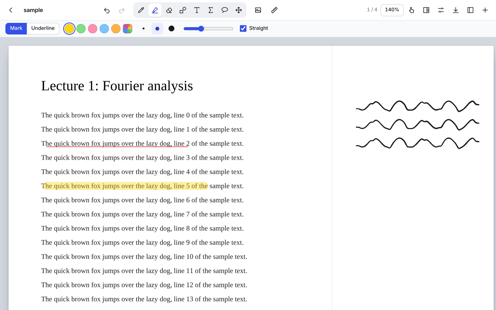
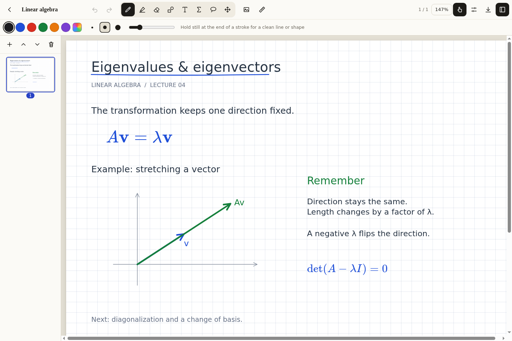
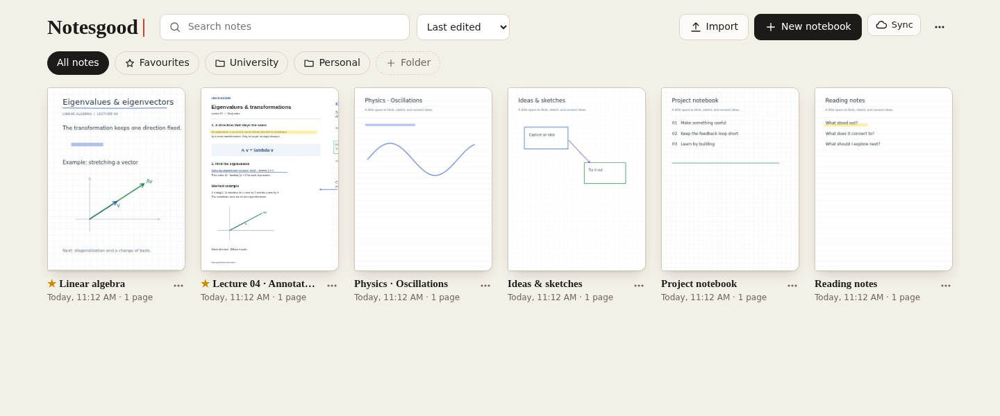

# Notesgood

## Install now

Choose your platform to open Notesgood, then confirm installation in your browser:

| Install Notesgood | Finish installing |
| --- | --- |
| **[Windows →](https://lucamezger.com/notesgood/)** | Open in Chrome → address-bar **Install** icon, or ⋮ → **Cast, save, and share → Install page as app**. |
| **[Android →](https://lucamezger.com/notesgood/)** | Open in Chrome → ⋮ → **Install and create shortcut → Install** (or **Add to Home screen → Install**, depending on your version). |
| **[iOS / iPadOS →](https://lucamezger.com/notesgood/)** | Open in Safari → **Share → Add to Home Screen → Add**. Leave **Open as Web App** on if shown. |
| **[Linux / NixOS →](https://lucamezger.com/notesgood/)** | Open in Chrome/Chromium → **Install** in the address bar or **Install page as app** in the browser menu. Launch Notesgood from your desktop's app menu. |

These links open the same installable web app (PWA); installation needs your confirmation.
You can also [use it immediately in your browser](https://lucamezger.com/notesgood/) without installing.
Browser help: [Chrome](https://support.google.com/chrome/answer/9658361?hl=en) ·
[Safari on iPhone](https://support.apple.com/en-gb/guide/iphone/iphea86e5236/ios).

## Why choose Notesgood over Goodnotes?

Built for handwritten lecture notes, PDF annotation, and maths. It may suit your workflow better if you want:

- **Space beside your PDFs:** add an adjustable writing margin to every page, then expand it later without moving your ink.
- **LaTeX beside your handwriting:** place rendered formulas anywhere, including in PDF margins, and use inline maths in text boxes.
- **Linux and NixOS alongside your other devices:** use the same app on Windows, Android, iPhone, and iPad.
- **Control over your notes:** notes are stored locally; optional sync uses your own PHP or Node server and a secret key, with no Notesgood account required. Publishing this code does not publish your notes.
- **Free, open source, and customisable:** MIT-licensed code, no Notesgood subscription. Self-hosted sync requires hosting.
- **An easier move from Goodnotes:** import exported PDFs, folders, or ZIPs while keeping folder structure; watch a PDF backup folder in supported browsers.

Also includes pressure-sensitive ink, highlighting, shapes, a lasso, folders, dark mode, PDF export,
and notebook backups. See [What it does](#what-it-does) and [current limitations](#not-there-yet).

**Vibe coded:** built iteratively with AI coding assistants.

## Screenshots

These screenshots show the running app with sample notebooks and a demo lecture PDF.

### PDF annotation

Read a PDF and write beside it in an adjustable margin.



### Notes and LaTeX

Combine ink, diagrams, text, and rendered formulas on a notebook page.



### Notebook library

Start with large folder tiles, open subfolders, and drag notebooks or entire folders to move them.
Sort by name, last edit, or creation date in either direction; your choice is remembered.



## Run it

A prebuilt copy is in `dist/`, so you only need Node to serve it:

```sh
nix develop            # NixOS: shell with Node (or use any Node >= 20)
node scripts/serve.mjs # http://localhost:5173
```

To work on the code:

```sh
npm install
npm run dev        # rebuilds on change, serves http://localhost:5173
npm run build      # production build into dist/
npm run typecheck
```

`dist/` is plain static files, so any web server or static host works.

### Android

Host `dist/` over HTTPS (any static host), open it in Chrome on the tablet and choose
**Install app**. It then runs full screen and works offline. For a first try on the same
network, `http://<your-pc-ip>:5173` works in the browser, but installing and offline use need HTTPS.
A Play-Store-style APK can be produced later by wrapping `dist/` with Capacitor; no code changes needed.

### NixOS

`nix run` serves `dist/` from the project directory. For a desktop window without browser
chrome: `chromium --app=http://localhost:5173`. In Firefox on X11, pen pressure needs
`MOZ_USE_XINPUT2=1`; on Wayland it works out of the box.

On Hyprland/XWayland, `scripts/notesgood-pen.py` bridges the integrated pen's eraser
button to the eraser and its second button to the lasso. It needs Python with
`python-xlib` and a window class of `notesgood`. Run it in the graphical session
(or as a user service). It only targets the focused Notesgood window; after
releasing the lasso button, the selection stays marked and can be moved repeatedly
until you tap outside it.

## Sync between devices

Notes sync through a small endpoint you host: `server/sync.php` for PHP hosting (Hostinger shared
hosting and similar) or `server/sync.mjs` for a VPS with Node. Both keep the data as plain files.

1. Put `sync.php` on your host (the deploy workflow below does this) with a `sync-key.txt` next to it
   containing one secret line of your choosing. The data lands in `sync-data/` beside it.
2. In the app, on every device: Library → **Sync** → enter the URL of `sync.php` and the secret.
   On the device that already has notes, press **Upload all notes from this device** once.

Changes are pushed while you write (every 45 s and when you leave a notebook) and pulled whenever the
library is shown, so a notebook edited on the tablet appears on the laptop the next time you open
the library there. If the same notebook is edited on two devices at once, the later save wins per page.
PDFs and pictures are uploaded once and downloaded on demand; a 50 MB lecture PDF is only ever
transferred once per device. Shared PHP hosts often cap uploads at 64–128 MB per file; larger PDFs
will not sync (the notebook still works locally).

## Deploying (GitHub Pages + Hostinger)

`.github/workflows/deploy.yml` builds the app on every push to `main` and deploys it to GitHub Pages.
If the repository has the secrets `FTP_HOST`, `FTP_USER`, `FTP_PASSWORD`, `FTP_DIR` (e.g.
`/public_html/notesgood/`) and `SYNC_KEY`, it also uploads the app and `sync.php` to that folder on your
Hostinger site, so `https://your-domain/notesgood/` is the installable app and
`https://your-domain/notesgood/sync.php` is the sync server. Any device, Android included, can then
install it from the browser's menu and use it offline.

## Installing it as an app

Use the [installation links at the top](#install-now) for Windows, Android, iOS/iPadOS, and Linux/NixOS.
The browser installs Notesgood with its own icon and app window. Notes are stored on the device;
offline use is available after the app and required resources have loaded over HTTPS.

There are currently no separate `.exe`, APK, or Linux package downloads. An Android APK can be built
from the hosted URL with Bubblewrap (Trusted Web Activity); see the deploy prompt in `docs/`.

## What it does

- **Library**: large folder tiles, nested folders, breadcrumbs, favourites, and search. Drag notebooks
  onto folders, move whole folder trees, or drop onto a parent breadcrumb to move back. PDFs dropped
  onto a folder import there. Sort folders and notebooks by name, last edit, or creation date,
  ascending or descending; the app remembers the view and sorting. Earlier Goodnotes imports remain accessible separately.
- **PDF import**: choose how much writing space to add to the right of every page (and its ruling).
  Up to 5x the page width. Change it later from the toolbar; ink keeps its position.
- **Tools**: pressure-sensitive pen with adjustable smoothing, highlighter (mark or underline, freehand or
  straight), eraser (whole stroke or partial), a ruler to draw along (R),
  On PDF pages, underlines and straight highlights snap to the printed text line under the pen, with the
  thickness taken from the font size (settings → Snap to printed text). shapes (line, arrow, rectangle,
  ellipse), text boxes, LaTeX blocks, lasso (move, resize, rotate, recolour, duplicate, delete, snap to
  grid, convert to LaTeX or text), undo/redo.
- **LaTeX**: the Σ tool places a rendered formula anywhere, including the PDF margin. Text boxes
  render `$...$` as inline maths.
- **Mouse**: click to select formulas, text or pictures; drag to move them. Double-click text or a
  formula to edit it. The mouse never draws or erases; your stylus tool stays ready for writing.
- **Pages grow downward**: write near the bottom of a PDF page and it gains half a page of space below;
  trim it again from the margin menu.
- **Handwriting → LaTeX / text**: lasso some handwriting and press *To LaTeX* or *To text*. This sends an
  image of the selected strokes to Claude or OpenAI, selected under Settings → Handwriting recognition.
  OpenAI supports GPT-5.4 mini and GPT-5.4 through the [Responses API](https://developers.openai.com/api/docs/guides/images-vision).
  Enter your own API key there; each provider's key and model stay separate in this browser and are
  never synced. Without a key the rest of the app works as before.
- **Dark mode** (Settings → Appearance): paper, ink, text and PDFs are inverted, pictures keep their colours.
- **Hold to straighten**: rest the pen at the end of a stroke and it becomes a clean line, rectangle,
  ellipse or triangle (settings: on/off and hold time).
- **Pictures**: paste (Ctrl+V), drop, or insert from the toolbar; move and resize with the lasso.
  Lock a picture so it stays put; unlock from the lasso options. Ctrl+C / Ctrl+V also copies lasso selections between pages.
- **Bulk import**: drop several PDFs, a folder, or a ZIP of PDFs (as GoodNotes exports them); folders are kept.
- **Pages**: sidebar with thumbnails; add, reorder and delete pages.
- **Resume reading**: remembers the exact position and zoom for each notebook on this device, including after reopening the app.
- **Settings**: pressure, hold-to-straighten and its delay, straight highlighter, finger drawing, text
  snapping, toolbar at the top or on the left side.
- **Export**: any notebook as a PDF (original PDF pages kept as they are, ink as vector paths, text and
  formulas as a 3x image layer).
- **Backup**: one notebook or all of them as a `.notesgood` file; importing it restores them as new copies.

### Input

| Device | Behaviour |
| --- | --- |
| Stylus | Always writes. The eraser end / barrel button erases. After the first stylus contact, fingers only scroll (palm rejection). |
| Finger | One finger scrolls, two fingers pinch-zoom. Toggle "draw with finger" in the toolbar for devices without a stylus. |
| Mouse | Draws. Middle button pans, Ctrl+wheel zooms. |

Shortcuts: `P` pen, `H` highlighter, `E` eraser, `S` shapes, `T` text, `M` LaTeX, `L` lasso, `V` move,
`Ctrl+Z` / `Ctrl+Shift+Z`, `Ctrl+0` fit width, `Delete` removes the selection.

## How it is built

No framework: TypeScript, bundled by esbuild. KaTeX renders maths, pdf.js renders PDFs.

| File | Role |
| --- | --- |
| `src/editor.ts` | Page layout, zoom/pan, pointer input, tools, undo, autosave |
| `src/render.ts` | Stroke/shape drawing, paper rulings, hit-testing geometry |
| `src/library.ts` | Notebook overview, PDF import dialog |
| `src/pdf.ts` | pdf.js wrapper and render queue (loaded on demand) |
| `src/db.ts` | IndexedDB storage |
| `src/export.ts` | PDF export (pdf-lib) and backup files |
| `src/sync.ts`, `server/` | Device sync client; PHP and Node sync servers |
| `src/thumb.ts`, `src/latex.ts`, `src/ui.ts` | Thumbnails, KaTeX helpers, small DOM helpers |

Writing latency: the stroke in progress is drawn straight from the pointer event (using all
coalesced stylus samples) onto a low-latency overlay canvas, and only the new segment is drawn
each time. Finished strokes are baked into a per-page canvas; only pages near the viewport hold canvases.

## Importing from GoodNotes

Choose **From Goodnotes** in the library to import PDFs, a ZIP, or a whole folder. The importer keeps
folders, handles nested PDF ZIP exports, and skips PDFs with the same content, even after renaming.
The original page layout is kept by default; extra writing space can be added in the import dialog.

**Goodnotes Web, Windows, and Android:** open a notebook → Share → Export as PDF. Goodnotes documents
this as a per-notebook workflow; you do not need a full-library export to start importing.
See [Goodnotes' export instructions](https://support.goodnotes.com/hc/en-us/articles/7353742824975-Export-documents-or-pages).

**On the installed Nix desktop:** completed PDF downloads from the dedicated Goodnotes browser app
are picked up automatically from Downloads while Notesgood's library is open, checked every minute.
Pause, resume, or check imports under **From Goodnotes**. The local helper uses Node 24 and reads a private snapshot of
the Fleet Goodnotes profile's download history; it imports only completed PDFs actually downloaded
from `web.goodnotes.com`. Unrelated downloads and PDFs merely prepared for Goodnotes are ignored.
The original files are kept. A changed export becomes a new notebook, leaving existing annotations intact.

Private migration exports can also be placed under `~/.local/share/notesgood/goodnotes-inbox/`, with a
subfolder for each Goodnotes folder. The local app preserves those folders, including repeated filenames
in different folders. An identical PDF previously imported into the generic Goodnotes folder is moved
into its source folder without replacing its pages or annotations. Keep this inbox outside the repository.
Separate inbox entries retain separate notebook identities even if their PDFs are identical. Automatic
imports and cover generation also continue while the desktop window is hidden.

**For PDF backups:** choose **Watch a backup folder…** and select a local PDF backup folder. In supported
browsers, Notesgood remembers that folder and checks for new or changed PDFs while the library is open.
The browser may ask you to reconnect the folder after restarting. Goodnotes Auto Backup must use PDF
or PDF + Goodnotes format; a native `.goodnotes` backup alone cannot be imported.

On iPad or Mac, you can select documents or folders and export them as PDF; import the resulting ZIP
here in one step. Existing handwriting stays visible as part of the PDF, so you can write on and beside
it, but cannot erase the old handwriting stroke by stroke. Native `.goodnotes` files need a PDF export first.

## Not there yet

- Sync is last-write-wins per page; there is no merge of simultaneous edits to the same page.
- The sync secret is a single shared key, fine for one person's devices, not for sharing with others.
- Partial (pixel) eraser, handwriting search, reading `.goodnotes` files directly.
- Pages are rendered as one bitmap each (capped at 10 megapixels), so very deep zoom gets soft.
